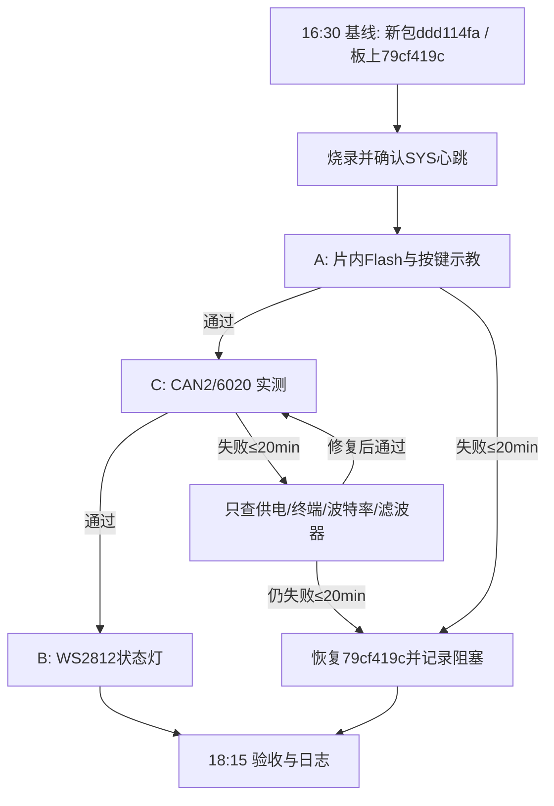
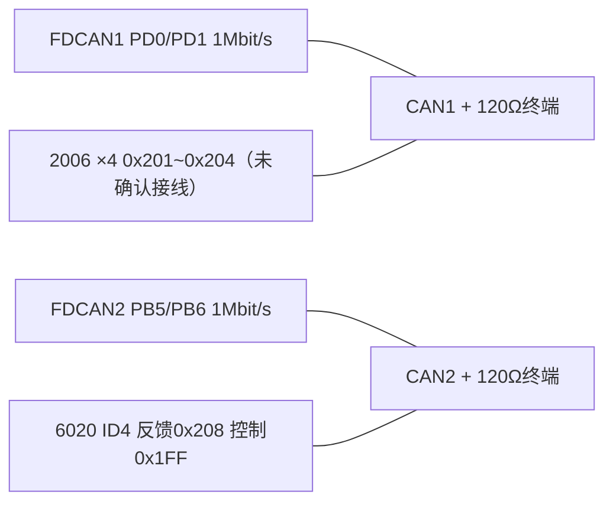
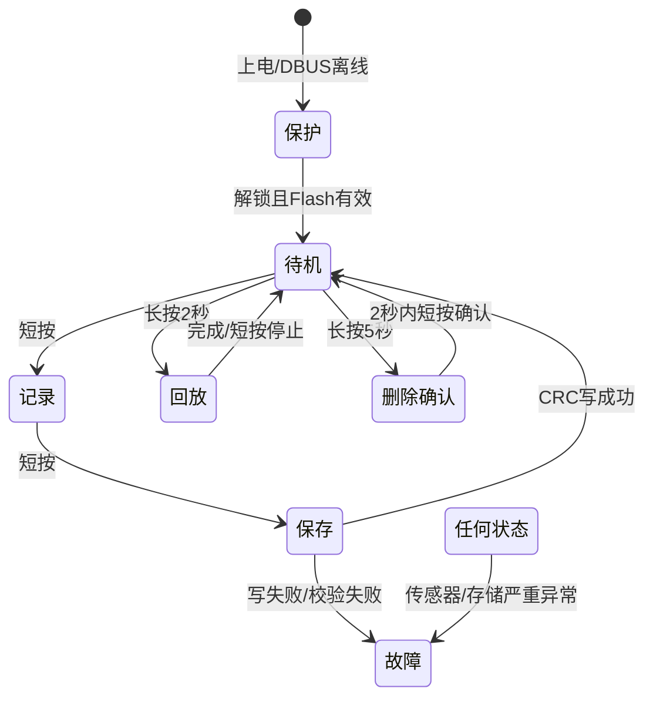

# 2026-11-25 下午自动迭代计划

> 启动：2026-11-25 16:30；当前已执行到 20:20，计划时间仅作原排期记录。
> 目标：片内 Flash 示教闭环、板载 WS2812 状态指示、CAN 链路实测。
> **当前状态（21:01）**：板上固件 SHA256 `01d4b265b93e88711e11514809eb9a86fd73af46a4dbeccdb216f306ca543378`，已运行；CAN2 位定时修正为 1Mbps，交换 CAN_H/L 后 `[CAN2] rx≈1.1k/s tec=0 rec=0 err=0` 连续 35s，**6020 双向通信闭环**。双舵机 ID002/001 通信通过，RAM 映射未持久化。**A Flash 与 B WS2812 尚未开始。**
> 执行边界：先完成 CAN1↔CAN2 物理桥接验证；不同时改代码、接线、供电和工具；本轮不发送非零电机电流。

## 一、工作项（按执行顺序）

`[P1] A 片内 Flash＋按键示教 | 512 点/20Hz、A/B 扇区、CRC、启动加载、短按记录/保存、长按回放 | 45min | PA15 按键、肩002/肘001双机在线 | 掉电后点数和姿态一致，保存≤100ms，加载≤1ms`

`[P1] C CAN 实测（现场已接：6020→CAN2；4×2006 在 CAN1 未确认接线） | CAN2收0x208、10Hz发0x1FF零电流并读TEC/REC | 25min | 24V、6020拨码ID=4/终端电阻、CANH/L | CAN2连续30秒rx增长且TEC=0`

`[P1] B WS2812 状态灯 | 使用PA7/SPI6单灯，按保护/就绪/记录/回放/故障显示 | 15min | A的状态接口 | 5种状态目视一致，状态变化到刷新≤20ms`

收尾 10 分钟：失败项恢复到已知良好包并记录；只追加 `Develop_Log/daily_review.md`，不 commit/push。

建议先做 A、C、B：A 是掉电保存证据链，C 决定明天底盘能否动；B 依赖 A 的状态定义，最后接最稳。

## 二、图

## 三、A：片内 Flash 与按键示教

### 实现范围

- H723 片内 Flash 1024 KiB；当前 ROM 124068 字节，预留最后两个 128 KiB 扇区：
  - A：`0x080C0000`（扇区 6）
  - B：`0x080E0000`（扇区 7）
- 每次保存交替写另一扇区，避免同一扇区“先擦后写”中断丢旧数据。预留后代码可用空余约 647 KiB，两个数据扇区共 256 KiB。
- 记录格式：版本、点数、采样周期、肩/肘/夹爪脉冲、时间戳、CRC32；512 点，20Hz，最长 25.6 秒。
- 只在示教 RAM（随机存取存储器）中采样；结束时一次写 Flash，不在 3ms 控制任务里逐点擦写。
- 上电先校验 A/B 两份记录，选择版本新且 CRC 正确的一份；两份都无效则保持保护模式，不执行回放。
- 按键（PA15，低电平有效）：
  - 短按：待机开始记录／记录结束并保存。
  - 长按 2 秒：回放；回放中短按停止。
  - 长按 5 秒：进入删除确认，2 秒内短按才擦除；超时取消。
- 按键消融用 30ms（毫秒）；长按判定用持续按住，不重复触发。
- 保存和回放期间 `arm_busy=1`，底盘目标速度强制为 0；DBUS 离线立即停止记录/回放并切保护。

### 性能与验收

| 指标 | 基线 | 目标 | 验收方法 |
|---|---|---|---|
| 保存总耗时 | 未实现 | ≤100ms | 从短按到日志 `save_done`，含擦除/写入/校验 |
| 启动加载 | 未实现 | ≤1ms | 上电到 `flash_load_done` 日志 |
| 采样 | 原64点RAM | 512点/20Hz | 记录2秒，点数35~45 |
| 掉电保持 | 重启丢失 | 点数/CRC/首中末点一致 | 保存→断电→上电→打印摘要 |
| 坏数据保护 | 无 | 单字节破坏后拒绝加载 | 台架制造CRC错误，不覆盖有效旧扇区 |
| 操作 | 依赖DBUS | 单键完成记录/保存/回放 | 连续10次无重复触发 |

## 四、C：CAN 实测（4×2006 在 CAN1，6020 在 CAN2）

### 已修代码事实

- 删除 `trigger_motor`、摩擦轮、旧 yaw/pitch、DM/LK 电机协议，以及 CAN2/CAN3 电机任务和队列。
- 删除原厂未构建的 `Bsp/can_bsp.*` 三路自测文件。
- FDCAN1 过滤器数从 1 修为 4，全部进 FIFO0；修复“规则数不足”和“奇偶规则写入容量为 0 的 FIFO1”两个接收阻断点。
- 电机发送改为栈上局部帧，不再使用 `motor_msg[3][5]`；删除 ID 0x208 的越界写。
- 构建：0 Error / 0 Warning；最终包 `ddd114fa…`，未烧录。

### 实测拓扑与门槛

1. 现场已确认：6020 接 FDCAN2，绿灯闪4次=ID4，反馈 0x208、控制 0x1FF；两个 UART 总线舵机已接。4 个 2006 在 CAN1 的接线尚未确认，不能当已测对象。
2. 24V 供电就绪后复位；CAN1 的 4 个 2006 共总线，CAN2 单独接 6020；每条总线终端约 120Ω。6020 拨码第 4 位控制其终端电阻接入。
3. USB-CAN 适配器设 Classic CAN、1 Mbit/s；先记录适配器型号/VID/PID/固件，不借用其他仓结论。
4. **先补 6020 的 0x1FF 零电流发送（10Hz）**，否则不能把“无反馈”归因于接线。
5. 底盘停止态继续发 0x200 零电流（50Hz）；本轮禁止非零电流和实际转向。

### 验收

- 连续 30 秒，CAN2 的 0x208 反馈持续增长，`TEC=0、REC=0`；CAN1 的 4 个 2006 各自反馈计数增长。
- 0x1FF 发送约 10Hz；USB-CAN 与 MCU 两侧错误帧增量均为 0。
- 记录每个 ID 的 rx 计数、发送计数、最后接收时间、温度、编码器值；无 HAL_BUSY、ORE、bus-off。
- 2026-11-25 21:01 实测：修正位定时 `60/6/1`(250kbps)→`24/2/2`(1Mbps)，并交换现场 CAN_H/L 后，`[CAN2] rx 36508→77321`（约 1.1k/s）、`tec=0 rec=0 err=0` 连续 35s，**达到本条验收门槛**。两个根因：位定时 250kbps、CAN_H/L 与丝印相反。
- 参考工程 `_ref_gimbal_6020`（yaw=6020，H723）用 96MHz PLL2Q + 8/8/3 = 1Mbps；GM6020 手册确认 1Mbps、ID4→0x208/0x1FF。
- 若后续再出现错误帧：先核对 H/L 与 24V/终端，再把位定时与 CAN1 对齐（24/2/2），不单独调采样点。

## 五、B：WS2812 状态指示

- 使用板载单灯：PA7/SPI6，GRB（绿-红-蓝）顺序；不启用现有 SPI1 的 16 灯遗留驱动。
- 颜色优先级：故障红闪＞记录黄＞回放紫＞保护蓝＞待机绿＞熄灭。
- 只在状态改变时刷新，故障闪灯 2Hz；颜色变化到灯刷新 ≤20ms。
- 验收：触发 5 种状态各 10 次，目视颜色/闪烁与状态日志一致；SPI6 不影响 BMI088 的 SPI2。

## 六、SMART 衡量

| 目标 | S 具体 | M 可测 | A 可达 | R 相关 | T 时限 | 判定 |
|---|---|---|---|---|---|---|
| A Flash/按键 | 明确 | 6项数字门 | 有条件 | 直接服务示教 | 16:40~17:25 | 8/9：缺双机同时在线验收 |
| C CAN | 明确 | CAN2 rx/TEC | 有条件 | 直接服务底盘 | 17:25~17:50 | 8/9：已实测，物理层未通 |
| B WS2812 | 明确 | 5态×10次/20ms | 是 | 服务调试安全 | 17:50~18:05 | 9/9 |

总体 **25/27**。两个“有条件”依赖用户提供实物状态，不假装硬件已就绪；任一硬件门槛不满足，该项只能记 L0/L1（构建/单向链路），不得记系统闭环。

## 七、停止条件

- 不开子代理；不改底盘巡线算法；不接 TF-mini；不把参照工程地图当实际赛道。
- 一次实验只改一个自变量；单假设 20 分钟或 2 次烧录无新证据就退回基线。
- 每次烧录登记：时间、拓扑、hex 哈希、唯一改动、动机、预期、原始输出、等级、是否复原。
- 关键约束重申：**先定真实硬件与 ID，再谈闭环；未烧录包不得写成板上固件；无实物证据不得写“通过”。**
